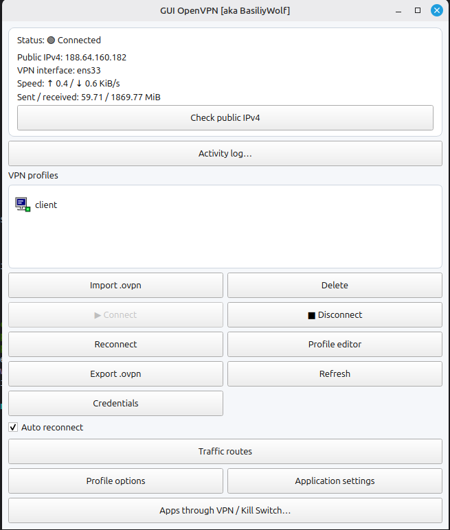

# GUI OpenVPN [aka BasiliyWolf] — 1.0.1

[Русский](README.ru.md) | [Home](README.md)

OpenVPN GUI client written in C++17 / Qt 6 for Linux Mint and Ubuntu. Features include NetworkManager `.ovpn` profile import, connect/disconnect, logs, interface statistics, Keyring credential storage, routes, and an experimental isolated application networking mode.

## Screenshots




## Install using DEB

This `amd64` DEB depends on Qt 6 packages including the `t64` variants; older Ubuntu or Mint releases may not provide them. Check dependency resolution first:

```bash
sudo apt update
sudo apt install ./gui-openvpn-basiliywolf-1.0.1-Linux.deb --assume-no
```

If dependencies resolve, install and launch:

```bash
sudo apt install ./gui-openvpn-basiliywolf-1.0.1-Linux.deb
gui-openvpn-basiliywolf
```

Uninstall:

```bash
sudo apt remove gui-openvpn-basiliywolf
```

## Build from source

```bash
chmod +x install-deps.sh build.sh
./install-deps.sh
./build.sh
./tests/smoke.sh
sudo cmake --install build
```

To build a DEB: `cd build && cpack -G DEB`.

## Security / known limitations

- The isolated-mode firewall / Kill Switch has not been independently audited or tested for leaks. Do not rely on it as a guaranteed protection.
- The test screenshot showed `ens33` as the VPN interface; verify that VPN-specific statistics track the actual tunnel interface.
- Some secondary dialogs still have mixed English and Russian content.
- NetworkManager mode runs the system-managed OpenVPN executable. Binary selection is only used by the isolated mode.
- NetworkManager must be running.

## License

This project is licensed under the GNU General Public License v3.0 (GPLv3). See [LICENSE](LICENSE).
