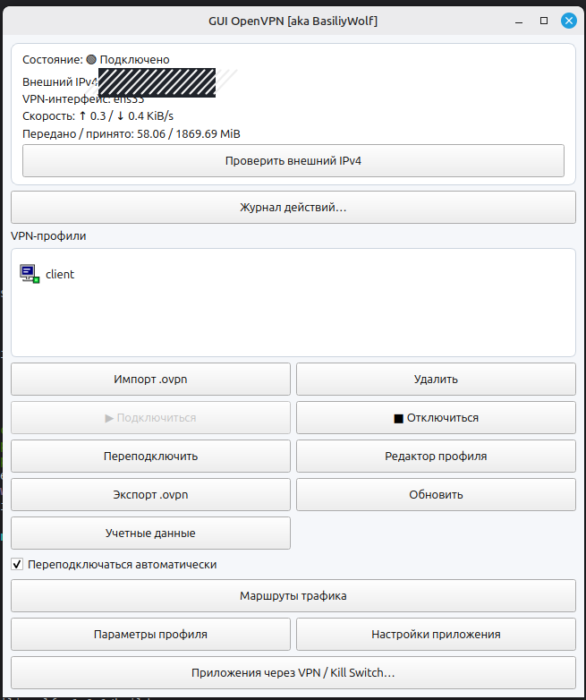

# GUI OpenVPN [aka BasiliyWolf]

[Русский](README.ru.md) | [English](README.en.md)

C++17 / Qt 6 OpenVPN desktop client for Linux Mint and Ubuntu.

See the language-specific README for installation and usage.

> Safety note: isolated-mode firewall functionality has not been independently verified against DNS/IPv6 leaks, and some dialogs still contain mixed RU/EN text. This is the provided v1.0.1 build, not a security-audited VPN client.

The screenshots below have public IP addresses permanently obscured with opaque hatching.

## Publishing / Публикация

See [Release notes (EN)](docs/publication/GITHUB_RELEASE.en.md) / [RU](docs/publication/GITHUB_RELEASE.ru.md).

## License

This project is licensed under the GNU General Public License v3.0. See [LICENSE](LICENSE).
