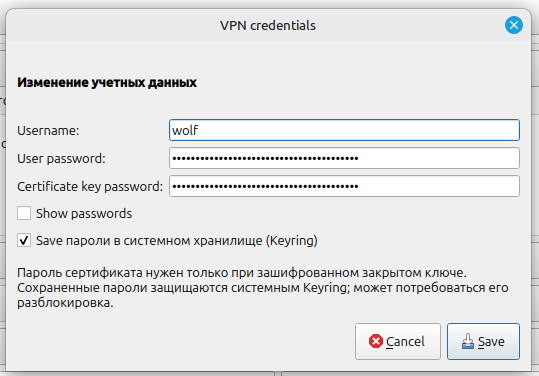
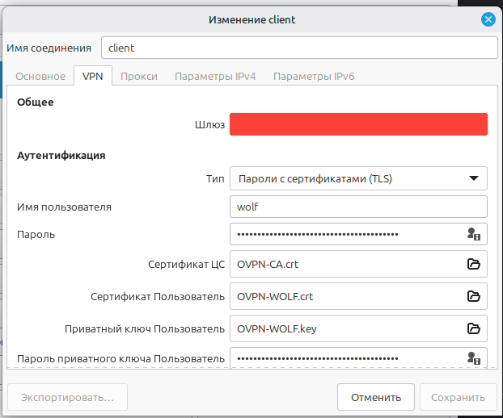
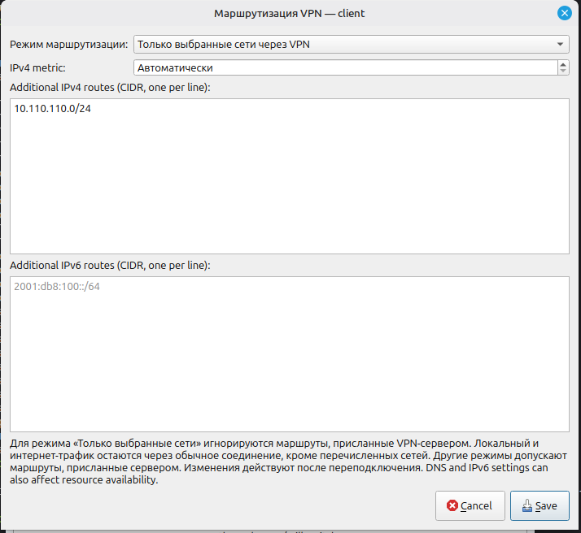
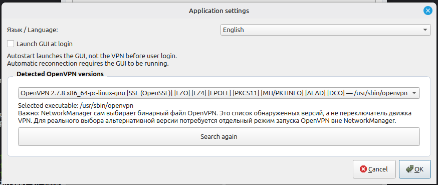
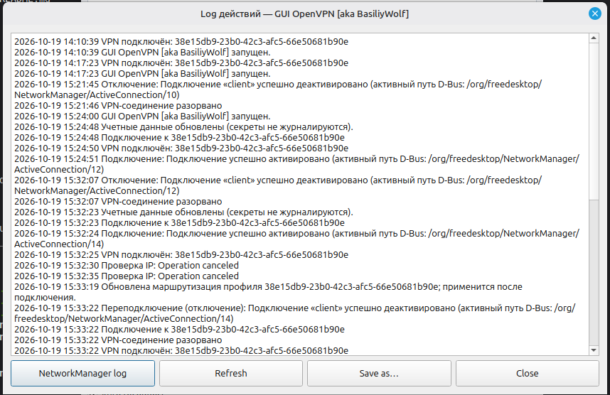
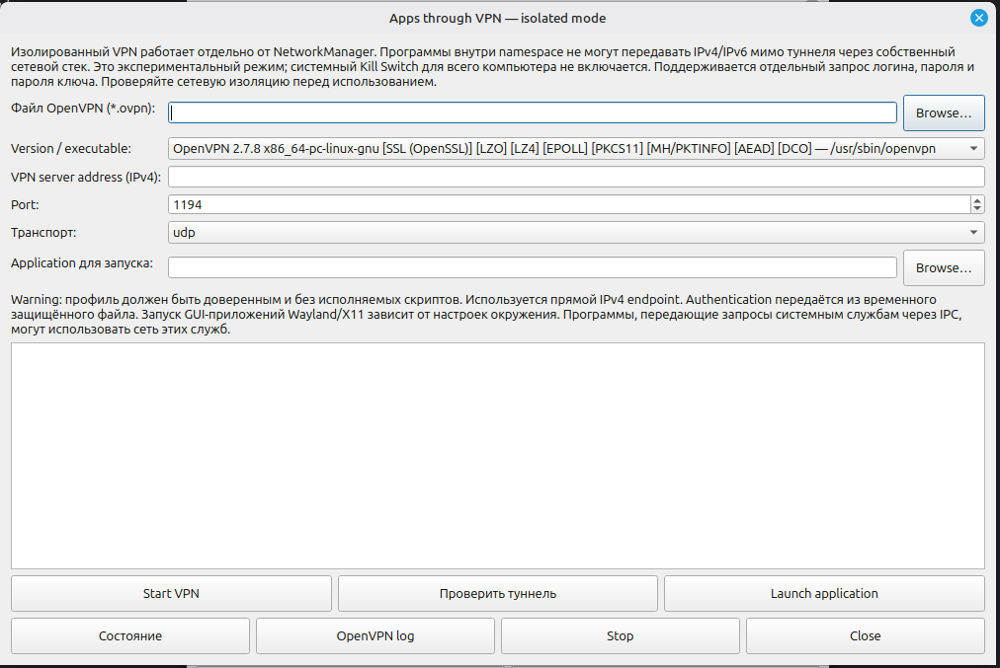

# GUI OpenVPN [aka BasiliyWolf] — 1.0.1

[English](README.en.md) | [Главная](README.md)

Клиент OpenVPN с графическим интерфейсом на C++17 и Qt 6 для Linux Mint и Ubuntu. Поддерживаются импорт профилей `.ovpn` через NetworkManager, подключение, журнал, статистика, сохранение секретов через Keyring, маршруты и экспериментальный изолированный режим приложений.

## Скриншоты









## Установка DEB

Убедитесь, что установлена совместимая Ubuntu/Linux Mint с пакетами Qt 6. Данный DEB собран под `amd64` и зависит от библиотек Qt 6 с суффиксом `t64`, поэтому на некоторых старых выпусках установка не получится. Проверьте зависимости без установки:

```bash
sudo apt update
sudo apt install ./gui-openvpn-basiliywolf-1.0.1-Linux.deb --assume-no
```

Если зависимости доступны, установите пакет:

```bash
sudo apt install ./gui-openvpn-basiliywolf-1.0.1-Linux.deb
```

Запуск через меню приложений или терминал:

```bash
gui-openvpn-basiliywolf
```

Удаление:

```bash
sudo apt remove gui-openvpn-basiliywolf
```

## Сборка из исходников

```bash
chmod +x install-deps.sh build.sh
./install-deps.sh
./build.sh
./tests/smoke.sh
sudo cmake --install build
```

Сборка пакета:

```bash
cd build && cpack -G DEB
```

## Безопасность и известные ограничения

- Изолированный режим и Kill Switch не прошли независимого аудита и сетевых тестов на утечки. Не считайте их гарантированной защитой.
- На тестовом скриншоте сетевой интерфейс определён как `ens33`; проверьте, что статистика относится именно к VPN-туннелю.
- Некоторые дополнительные диалоги содержат смешанные RU/EN строки.
- Режим NetworkManager использует системный бинарник OpenVPN; выбираемый бинарник работает в отдельном изолированном режиме.
- Требуется установленная и работающая служба NetworkManager.

## Лицензия

Проект распространяется на условиях GNU General Public License v3.0 (GPLv3). Полный текст — в [LICENSE](LICENSE).
